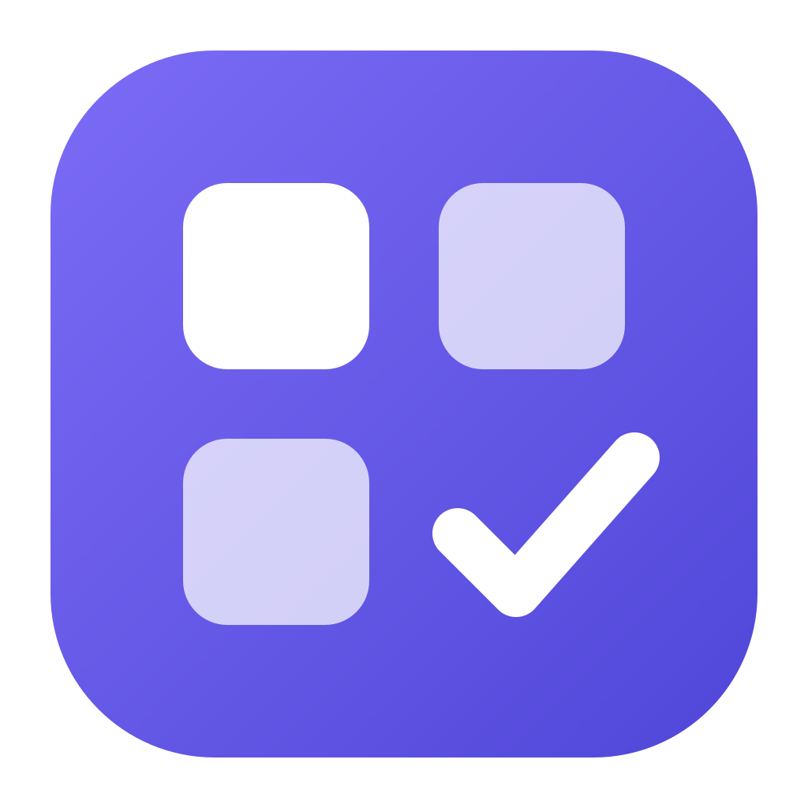
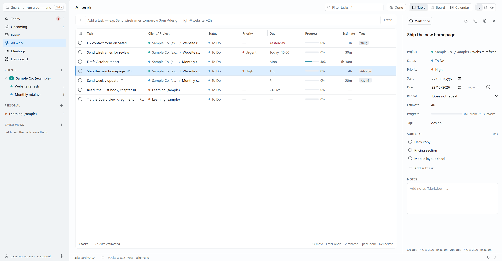

<p align="center">
  
</p>

<h1 align="center">Taskboard</h1>

<p align="center">
  <strong>A fast, local-first planner for people who juggle many projects, organized your way.</strong><br>
  Tasks, a Kanban board and a calendar with meetings, working hours and a meeting-slot finder.<br>
  Works with Claude, Codex and other AI assistants over MCP.
</p>

<p align="center">
  <a href="https://github.com/Muneeb-Ahmad-Ch/TaskBoard/actions/workflows/ci.yml"></a>
  
  <a href="LICENSE"></a>
  
</p>

<p align="center">
  <a href="#install">Download</a> ·
  <a href="#features">Features</a> ·
  <a href="#work-with-an-ai-assistant">AI assistants</a> ·
  <a href="docs/SHORTCUTS.md">Shortcuts</a> ·
  <a href="CHANGELOG.md">Changelog</a> ·
  <a href="#build-from-source">Build</a> ·
  <a href="#license">License</a>
</p>

<p align="center">
  <picture>
    <source media="(prefers-color-scheme: dark)" srcset="docs/assets/screenshot-dark.png">
    
  </picture>
</p>

Windows desktop app. No account, no cloud, no telemetry: your data stays in a
single SQLite file on your computer. Free for personal use; commercial use
needs permission (see [License](#license)).

## Features

- **Your own sections → groups → projects → tasks → subtasks.** Name the
  sidebar sections anything (Clients, Teams, Departments, Family…) and say
  what one group in each is called. First run offers ready-made setups
  (Freelancer, Company, Personal life) or a blank start. Click a section to
  see all its work with progress; drag sections, groups and projects to
  reorder or move them, drop tasks onto a project, and pin the projects you
  use daily.
- **Three views of the same data.**
  - *Table*: virtualized (50,000 tasks scroll smoothly), inline editing,
    sorting by any column, grouping (by status, priority, project, group,
    due date or date added) with collapsible groups, resizable columns, an
    Added column, multi-select bulk edits, a right-click menu on every row.
    Above it, the **schedule strip** shows the list's meetings and time
    blocks coming up (a client's calls next to its tasks).
  - *Board*: drag and drop (mouse or keyboard), custom columns per project,
    WIP limits, swimlanes by group / project / priority, and card order by
    hand or sorted (due date, priority, date added…).
  - *Calendar*: month, week, day and agenda; drag to create, move and resize;
    working hours shading and daily capacity.
- **Filter** the table and the board by priority, status, tag, project, due
  date (overdue, today, next 7 days, no date) and date added; what's on
  shows as chips you can remove one by one.
- **Board columns that match how work flows**: Backlog, To Do, In Progress,
  **Waiting** (on someone's reply or approval), Review, Done, or your own.
  Ctrl+K → "Add a Waiting column to every project" brings older projects up
  to date in one step.
- **Archive** finished or parked tasks instead of deleting them (right-click,
  or select and press A; "Archive N completed" clears a list). They stay out
  of every list and come back from Settings → Data with their subtasks.
- **Quick add** from anywhere (Ctrl+Shift+Space):
  `Send invoice fri 3pm #admin !high @website ~30m every month`.
- **Reminders**: one page for everything that will remind you (tasks with
  a time, meetings) and every repeating task or series, with the coming
  dates of "every month" tasks shown ahead of time. New reminder makes one
  in a few clicks: what, when, and how it repeats. Any task or meeting can
  remind at its own time, and a reminder can be snoozed.
- **Meetings** with links, attendees, notes, reminders with a Join button,
  repeating series (edit one, this-and-following, or all), and optional
  "counts as work time". A Meetings page lists what's coming up (or past),
  by day and group, with Join buttons.
- **Find a slot**: free time inside your working hours *and* the other
  side's hours in their time zone (set per group), with buffers, meeting caps and "copy
  availability" text.
- **Saved views**: keep any combination of scope, filter, sort and view in
  the sidebar and command palette.
- **Markdown notes** on tasks, meetings and groups (rendered safely, links
  open in your browser). A meeting's "- [ ]" action items become tasks in
  one click.
- **Time and progress**: task timer, logged hours per group, task progress
  from subtasks (color-coded, ✓ when done), and progress (% and done/total)
  on every list: Today, Upcoming, Inbox, All work, each section, group and
  project, with time left, meetings coming up and overdue tasks. Book **time
  blocks** for a task from its panel. Dashboard with streaks and project
  burndown.
- **Repeating tasks**: fixed schedules (every Friday) or after completion
  (every! 3 days).
- **Safe by design**: every change can be undone (bulk edits as one step),
  crash-tested storage, daily backups with retention, restore, and
  export/import (JSON, CSV, ICS; imports from Todoist, Trello, Notion CSV).
- **Updates itself**: Settings → Updates checks GitHub for a new version,
  shows what's new, and installs it in place: a signed download, a backup of
  your data, and Taskboard reopens on the new version. No installer to find
  and run.
- **Modern Windows UI**: light and dark themes, accent colors, Mica, tray icon,
  start with Windows, Windows notifications; zoom from 80% to 150%
  (Ctrl + / Ctrl −); keyboard-first and checked with axe-core against WCAG
  2.2 AA. Works down to small windows (the sidebar becomes a drawer).
- **Make it yours** (Settings → Sidebar, Sections, Views & table, Board
  columns): show, hide and reorder sidebar items, sections, view tabs and
  table columns; choose the board columns (statuses) new projects start
  with; resize the sidebar, the task panel and columns by dragging their
  edges. Settings has a search box: type "zoom" or "backup" to jump there.

## Work with an AI assistant

Taskboard is an **MCP server**, the standard that Claude Desktop, Claude Code,
Codex, Cursor and other assistants use to work with apps. Once connected, an
assistant can do what you can in the app: sections, groups, projects and
pins; tasks and subtasks (board columns by name, bulk edits, archiving);
meetings and time blocks (one occurrence or a whole series, booking time
for a task, finding free slots); working hours and days off; timers and
logged time; saved views, reminders and backups. Everything it changes is
undoable (Ctrl+Z) and appears in the app within a second. It can change a
few settings (Start with Windows, Keep running in the tray, leaving out
repeated names) but never its own access, backups or imports.

1. Open **Settings → AI assistants** (or Ctrl+K → "Connect an AI assistant…").
2. Click **Copy config** next to your assistant and paste it where that
   assistant keeps its MCP servers (the page says where). For Claude Code it
   is one command: `claude mcp add tb -- "<path to taskboard-app.exe>" --mcp`.
3. Click **Run test** to check the connection, then ask your assistant to
   "list my open tasks in tb" or "add a task to Website: ship the homepage
   Friday". The server is set up as **tb**, and the assistant knows that "tb"
   means Taskboard.

The same page has an **on/off switch** and shows which assistants have
connected and when. Nothing leaves your computer unless the assistant you
connect sends it.

Under the hood: `taskboard-app.exe --mcp` (or `taskboard mcp` from the CLI)
speaks JSON-RPC over stdio against the same database file; the tool list and
protocol tests live in `crates/taskboard-mcp`.

## Install

Download the latest installer from
[Releases](https://github.com/Muneeb-Ahmad-Ch/TaskBoard/releases)
(`Taskboard_x.y.z_x64-setup.exe`, or the `.msi`). Windows 10 (1809+) and
Windows 11. From version 0.5 on, Taskboard updates itself (Settings →
Updates); 0.4 and earlier need this one manual install to get there.

Installers are currently **not code-signed**, so Windows SmartScreen may warn
on first run ("More info" → "Run anyway").

## Build from source

Requirements: Rust (the version in `rust-toolchain.toml` installs
automatically), Node 22+, pnpm, and the
[Tauri prerequisites for Windows](https://tauri.app/start/prerequisites/)
(WebView2 is already part of Windows 10/11).

```bash
cd apps/taskboard-app/ui
pnpm install
pnpm app:dev       # run the app in development
pnpm app:build:unsigned   # build NSIS + MSI installers into target/release/bundle
                          # (app:build also signs update packages; needs the key, see RELEASING.md)
```

Checks:

```bash
cargo fmt --all --check
cargo clippy --workspace --all-targets -- -D warnings
cargo test --workspace              # core, CLI and MCP tests; regenerates TypeScript bindings
cd apps/taskboard-app/ui && pnpm check && pnpm test && pnpm build
```

The `taskboard` CLI (`cargo run -p taskboard-cli -- --help`) works on the same
database: add tasks with Quick Add syntax, list, undo, serve an AI assistant
with `taskboard mcp`, and `seed` a large demo database for benchmarks.

## Project layout

```
crates/taskboard-core   domain logic, SQLite storage, queries, recurrence,
                        reminders, backups, import/export (no UI code)
crates/taskboard-cli    command-line tool over the core
crates/taskboard-mcp    MCP server for AI assistants (stdio JSON-RPC over the core)
apps/taskboard-app      Tauri 2 shell (src-tauri) + Svelte 5 UI (ui)
docs/                   SPEC, ARCHITECTURE, DATA_MODEL, SHORTCUTS, RELEASING, ROADMAP
```

## Privacy

The only request Taskboard makes on its own is the **update check**: at
startup and every few hours it downloads a small file (`latest.json`) from
this repository's GitHub releases to see whether a newer version exists.
Nothing about your data is sent, and you can turn it off in Settings →
Updates. Otherwise it only opens links you click (meetings, the changelog),
in your browser. An AI assistant you connect runs on your computer
and talks to Taskboard locally; what it sends to its own service is up to that
assistant, and you can turn its access off in Settings → AI assistants. Your data lives in
`%APPDATA%\app.taskboard.desktop\taskboard.db`, with backups in the
`backups` folder next to it.

## License

Taskboard is **free for personal use** and other noncommercial use under the
[PolyForm Noncommercial License 1.0.0](LICENSE). That covers individuals,
hobby projects, charities, schools and public institutions.

**Commercial use needs permission.** This includes using Taskboard in or for a
business, or selling or bundling it. Email
muneeb.ahmad.freelancing@gmail.com to ask for a commercial license.

Copyright 2026 Muneeb Ahmad.
